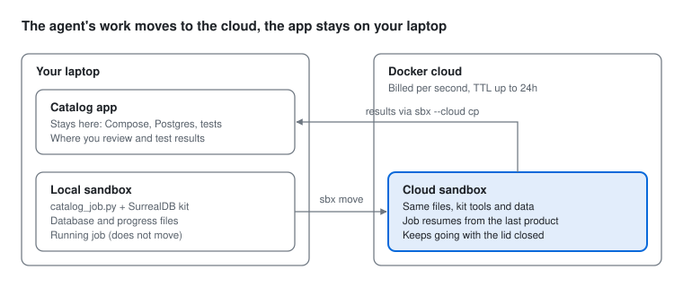

# Local to Cloud with Docker Sandboxes: Product Catalog Workshop

Start a long product catalog job in a local Docker Sandbox, move the sandbox to the cloud halfway through, and finish the job there.

No AI model key or third-party account is needed. You only need a Docker account with Cloud Sandboxes access.



## The idea

A sandbox is the agent's workspace: the agent, the tools a kit adds, a copy of the code it works on, and its working state. Your app does not live there. It keeps running on your laptop, in CI, or in production.

In this workshop, a resumable catalog job stands in for agent work, so everyone can run it without a model key.

**Why move to the cloud at all?** Move when the work will outlive your laptop session: the job runs for hours, you need to close the lid or travel, or you want many agents running at once without slowing your machine.

**Duration:** about 75 minutes, including setup.

**By the end, you can:**

- Create a sandbox with a kit and no workspace mount
- Run a long job inside it and check its progress from outside
- Move the sandbox to the cloud with a TTL and a safe timeout action
- Prove what moved (files, kit tools, data) and what did not (processes, secrets, mounts)
- Bring results back to your laptop and clean up

## What's in this repo

| File | What it is |
| --- | --- |
| [`catalog_job.py`](catalog_job.py) | The resumable catalog job you run in the sandbox |
| [`tests/simulate_move.sh`](tests/simulate_move.sh) | Tests the job's resume logic without sbx |
| [`INSTRUCTOR.md`](INSTRUCTOR.md) | Checklist and notes for running the workshop |
| [`BONUS-AGENT-DEMO.md`](BONUS-AGENT-DEMO.md) | Stage demo with Claude Code on a real app |

## Prerequisites and setup (10 min)

Each attendee needs a Docker account with an active Docker Agentic Platform plan, which is what enables Cloud Sandboxes. That is the only account in this lab.

| Need | Details |
| --- | --- |
| sbx CLI | v0.45.1 or later. macOS: `brew install docker/tap/sbx`. Windows: `winget install -h Docker.sbx` |
| Docker account | Signed in with `sbx login` |
| Cloud Sandboxes | Active Docker Agentic Platform plan (pay as you go, billed per second) |
| Workshop file | Clone this repo, or download `catalog_job.py` |
| Architecture | On Apple Silicon, confirm your cloud account supports arm64. `sbx move` does not convert between amd64 and arm64 |

Run these checks before Lab 1:

```
git clone https://github.com/ajeetraina/local-to-cloud-sandbox-demo.git
cd local-to-cloud-sandbox-demo
sbx version
sbx login
sbx ls
sbx --cloud ls
```

Both `ls` commands should run without errors. An empty list is fine.

## Lab 1: Create a local sandbox with a kit (10 min)

You create a sandbox with the built-in Shell agent and the SurrealDB kit, with no workspace mount, so everything in it can move.

1. Create the sandbox:

    ```
    sbx create --name catalog-lab --kit docker.io/ajeetraina777/sbx-surrealdb-kits:latest shell
    ```

2. Copy the job into the sandbox:

    ```
    sbx cp ./catalog_job.py catalog-lab:/home/agent/catalog_job.py
    ```

3. Check that the kit installed its tools:

    ```
    sbx exec catalog-lab python3 -c "import surrealdb; print('kit ready')"
    ```

You should see `kit ready`.

**What to notice:**

- **Shell** is sbx's agent-less sandbox. It needs no model key, so you act as the agent in this lab.
- **No path after `shell`** means no folder from your laptop is mounted. Mounted folders stay on the host and never move to the cloud.
- **The kit** added the SurrealDB Python SDK into the sandbox filesystem. It is an embedded database: no server to start, no account. Its data lives under `/home/agent`, so it moves with the sandbox.

## Lab 2: Start the catalog job locally (10 min)

The job cleans up 500 messy products, one every 0.6 seconds, so a full run takes about 5 minutes. You start it on your laptop and move it before it finishes.

1. Start the job in the background:

    ```
    sbx exec catalog-lab bash -lc 'nohup python3 /home/agent/catalog_job.py run > /home/agent/run.log 2>&1 &'
    ```

2. Check progress. Run this a few times:

    ```
    sbx exec catalog-lab python3 /home/agent/catalog_job.py status
    ```

    You should see a line like `212/500 products done | last: Classic Lantern | on <host> | ...`

3. Wait until it passes about 150 products, then go straight to Lab 3.

**What the job does per product:** trims and title-cases the name, sets the price to .99, picks a category from the name, and flags a duplicate UPC if it has seen it before. These are the same fields as the [catalog-service-node](https://github.com/dockersamples/catalog-service-node) app (name, UPC, price). It saves after every product, so it can stop at any moment and resume later.

**Tip:** the `status` command reads a small progress file, so it is safe while the job runs. Don't run `report` until the job has stopped, because the database is locked while the job writes to it.

## Lab 3: Move the sandbox to the cloud (10 min)

One command captures the sandbox filesystem and recreates it in Docker's cloud. The job is mid-run, and that is the point.

1. Move it:

    ```
    sbx move catalog-lab --to cloud --name catalog-lab --ttl 45m --on-timeout hibernate --force
    ```

    Result:
   
    ```
    warning: Secrets managed by sbx are not copied. The destination may use its own secrets; you may need to sign in again.
    warning: Credentials saved in copied files can still travel with the sandbox.
    warning: Local network policies are not copied. The destination uses cloud network policies.
    Warning: source limits are missing for CPU and memory; using cloud defaults for those limits. The source's actual allocation may be larger.
    Using cloud shape small (2 vCPU / 4096 MiB).
    Pushing sandbox catalog-lab to cloud ...
    Upload complete.
    ✓ move sandbox catalog-lab to cloud (1m6s)
    ✓ Moved to cloud sandbox catalog-lab (sbx_001m4mew9fgwh94zbwne62gmvz5)
    Attach with:  sbx --cloud run sbx_001m4mew9fgwh94zbwne62gmvz5
    Created cloud template tmpl_001m4metx2983pee0195k6vjncn to back it; remove it with `sbx --cloud template rm tmpl_001m4metx2983pee0195k6vjncn` once the sandbox is deleted.
    Expires in 44m; the sandbox will then be stopped (it can be started again later).
    try: sbx --cloud ttl sbx_001m4mew9fgwh94zbwne62gmvz5
    ```


3. Find the cloud sandbox's identifier. The move keeps the `--name` you gave it, unless that name is already taken in the cloud, in which case it adds a short unique suffix. Either the `SANDBOX` name or the `ID` works in later commands:

    ```
    sbx --cloud ls
    ```

    Result:
   
    ```
    SANDBOX             AGENT   ID                                STATUS    PORTS   WORKSPACE
   shell/catalog-lab   shell   sbx_001m4mew9fgwh94zbwne62gmvz5   running           -
   ```

4. Save it for the rest of the lab (use the name or ID from the `ls` output):

    ```
    CLOUD=catalog-lab
    ```

| Flag | What it does |
| --- | --- |
| `--to cloud` | Moves the local sandbox up to the cloud |
| `--name catalog-lab` | Base name of the cloud sandbox. Without it the default is `moved-` plus the source name |
| `--ttl 45m` | How long the cloud sandbox lives. Range 15s to 24h; server default is typically 1h |
| `--on-timeout hibernate` | When the TTL ends, hibernate the sandbox (stop it in place) instead of deleting it, so no one loses work. If the server can't honor it, the move fails up front. The only other value is `delete` |
| `--force` | Skips the confirmation prompt |

**What to notice:** the move stops the local sandbox while it captures it. Also, don't add the global `--cloud` flag to `sbx move`. The command already spans both sides.

## Lab 4: Prove it moved and resume in the cloud (10 min)

The cloud sandbox has the same files, the same kit tools, and the same database, so the job picks up where it stopped.

1. Check progress. It shows the last product finished on your laptop:

    ```
    sbx --cloud exec $CLOUD python3 /home/agent/catalog_job.py status
    ```

2. Check that the process itself did not move:

    ```
    sbx --cloud exec $CLOUD bash -lc "pgrep -f '[c]atalog_job' || echo 'job is not running'"
    ```

    You should see `job is not running`. The data moved, the process did not. (The `[c]` in the pattern is a small trick so `pgrep` doesn't match its own command line and report a false positive.)

3. Check the kit came along:

    ```
    sbx --cloud exec $CLOUD python3 -c "import surrealdb; print('kit ready')"
    ```

4. Resume the job in the background:

    ```
    sbx --cloud exec $CLOUD bash -lc 'nohup python3 /home/agent/catalog_job.py run > /home/agent/run.log 2>&1 &'
    ```

5. Check progress again. The count goes up from where it stopped, and the host is now the cloud sandbox:

    ```
    sbx --cloud exec $CLOUD python3 /home/agent/catalog_job.py status
    ```

6. When it reaches 500/500, get the report:

    ```
    sbx --cloud exec $CLOUD python3 /home/agent/catalog_job.py report
    ```

The report shows how many products were processed on each host, for example 232 on the laptop and 268 in the cloud. That split is the proof: one job, two machines, no lost work.

**Discussion point:** this is the agent pattern. Swap the job for a coding agent working through a backlog, and the move works the same way.

## Lab 5: What moves and what doesn't (10 min)

A move copies a filesystem snapshot, nothing more. Anything that is not a file inside the sandbox stays behind or must be set up again in the cloud.

| Thing | Moves? | What to do |
| --- | --- | --- |
| Files under `/home/agent` (job, database, logs) | Yes | Nothing |
| Tools installed by the kit | Yes | Nothing |
| The kit's network rules | Yes, applied at the destination | Nothing |
| Running processes | No | Start the job again, as in Lab 4 |
| Secrets in the local store | No | Set them again with `sbx --cloud secret set` |
| Network rules you added locally | No | Add them with `sbx --cloud policy allow network` |
| Mounted workspace folders | No | Clone inside the sandbox, or copy with `sbx --cloud cp` |
| Changes after the move | No sync | The local copy and the cloud copy are now separate |

**Try it:** look at the network rules the kit brought with it:

```
sbx --cloud policy ls $CLOUD
```

## Lab 6: Bring results home and clean up (10 min)

The work finished in the cloud, but the result belongs on your laptop, next to your real app.

1. Copy the report down:

    ```
    sbx --cloud cp $CLOUD:/home/agent/catalog-job/report.json ./report.json
    cat report.json
    ```

2. Optional: move the whole sandbox back down, to show the move works both ways:

    ```
    sbx move $CLOUD --to local --name catalog-back
    sbx exec catalog-back python3 /home/agent/catalog_job.py report
    ```

    Same report, now on your laptop. The cloud copy stays until you remove it.

3. Clean up everything:

    ```
    sbx --cloud rm $CLOUD
    sbx rm catalog-lab
    sbx rm catalog-back
    ```

    Skip the last line if you didn't do step 2. Run `sbx ls` and `sbx --cloud ls` to confirm nothing is left. Cloud compute is billed per second, so remove cloud sandboxes when you're done.

4. The move to the cloud also created a backing template. Removing the sandbox does not remove it, so clean it up too:

    ```
    sbx --cloud template ls
    sbx --cloud template rm <template-id>
    ```

    Use the template ID that `sbx move` printed, or the one listed next to `moved-catalog-lab` in `template ls`.

## Troubleshooting

| Symptom | Likely cause | Fix |
| --- | --- | --- |
| `sbx --cloud ls` fails | Not signed in, or no Agentic Platform plan | `sbx login`, then check the plan in your Docker account |
| Move fails on platform | Laptop is arm64, cloud account does not support it | Use an amd64 machine, or enable arm64 in the account |
| `$CLOUD` commands say sandbox not found | Wrong identifier | Copy the exact `SANDBOX` name or `ID` from `sbx --cloud ls`; a suffix is only added if the name was already taken |
| `SurrealDB SDK not found` | Sandbox created without the kit | Recreate with the `--kit` flag from Lab 1 |
| `report` errors while the job runs | The database is locked by the running job | Use `status` until the job finishes |
| Progress stops in the cloud | Job was not restarted after the move | Run Lab 4 step 4 |
| Cloud sandbox disappeared | TTL ran out | Extend early with `sbx --cloud ttl +30m $CLOUD` (max 24h from creation) |
| Want a faster or slower job | Default is 0.6s per product | Use `JOB_DELAY=0.3 python3 ...` inside the `bash -lc` string |

**Note:** the SurrealDB kit's vector search uses Docker Model Runner on the host, which a cloud sandbox cannot reach. This lab does not use it, so don't run the kit's `travel.py` runbook in the cloud.

## Sources

- [sbx move reference](https://docs.docker.com/reference/cli/sbx/move/)
- [Move a sandbox](https://docs.docker.com/ai/sandboxes/cloud/move/)
- [Cloud sandboxes](https://docs.docker.com/ai/sandboxes/cloud/)
- [Compare local and cloud sandboxes](https://docs.docker.com/ai/sandboxes/cloud/local-vs-cloud/)
- [Cloud network policy](https://docs.docker.com/ai/sandboxes/cloud/network-policy/)
- [sbx create](https://docs.docker.com/reference/cli/sbx/create/), [exec](https://docs.docker.com/reference/cli/sbx/exec/), [cp](https://docs.docker.com/reference/cli/sbx/cp/), [ttl](https://docs.docker.com/reference/cli/sbx/ttl/), [attach](https://docs.docker.com/reference/cli/sbx/attach/)
- [sbx-kits-surrealdb](https://github.com/ajeetraina/sbx-kits-surrealdb)
- [Getting started with Docker Cloud Sandboxes](https://www.ajeetraina.com/getting-started-with-docker-cloud-sandboxes/)
